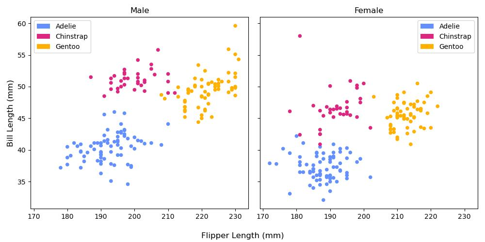
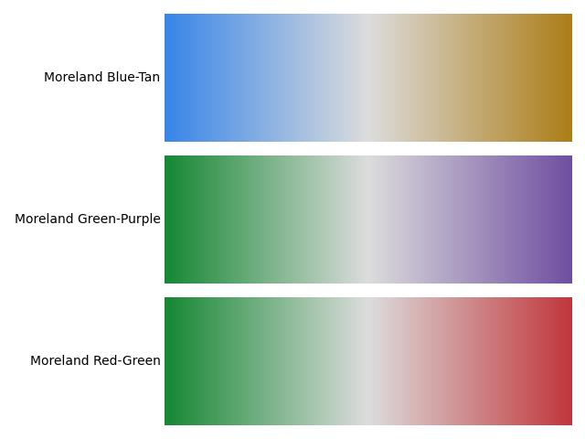
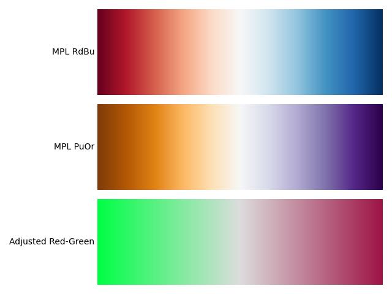
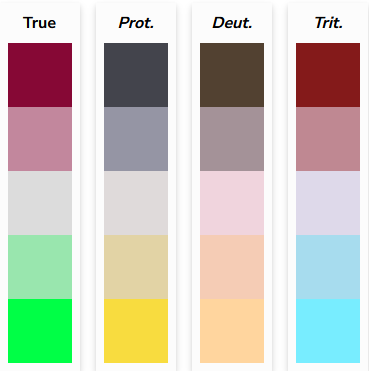
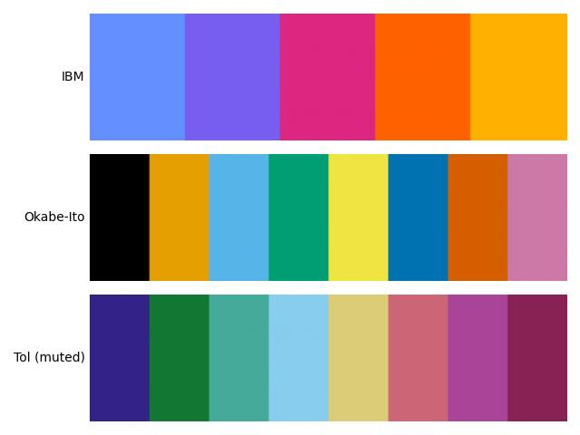
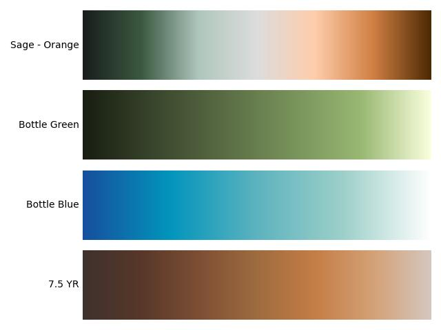
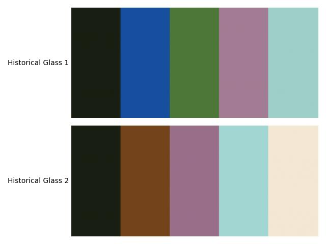

# Matplotlib Colormaps

## Background

The Python data visualization package [Matplotlib](https://matplotlib.org/) has a ton of [built-in color maps](https://matplotlib.org/stable/users/explain/colors/colormaps.html) including popular sequential color maps like ```viridis```. Matplotlib also lets you create your own color maps using the ```ListedColormap``` class for categorical maps and ```LinearSegmentedColormap``` class for gradients.

This repository contains colormaps that I use frequently and which are not included as built-in colormaps in Matplotlib. I found myself copying and pasting them frequently into new scripts, so I decided to compile them into one place.

## Usage

### Copy the code for a single color map

If you just want to use a single one of these color maps, you can copy the code from ```favorite_cmaps.py``` into your script and use the variable wherever Matplotlib asks for a color map.

```
import matplotlib.pyplot as plt
from matplotlib.colors import ListedColormap #Be sure to import the ListedColormap class as well
import pandas as pd

palmer = pd.read_csv('https://raw.githubusercontent.com/allisonhorst/palmerpenguins/refs/heads/main/inst/extdata/penguins.csv')

ibmcolorblind = ListedColormap(["#648FFF", "#785EF0", "#DC267F", "#FE6100","#FFB000"])

female = palmer[palmer['sex'] == 'female']
male = palmer[palmer['sex'] == 'male']

fig, ax = plt.subplots(1, 2, sharex = True, sharey = True, figsize = (10, 5))
male.plot.scatter('flipper_length_mm', 'bill_length_mm', c = 'species', cmap = ibmcolorblind, ax = ax[0])
ax[0].set_title('Male')
ax[0].set_xlabel('')
ax[0].set_ylabel('Bill Length (mm)', fontsize = 12)
female.plot.scatter('flipper_length_mm', 'bill_length_mm', c = 'species', cmap = ibmcolorblind, ax = ax[1])
ax[1].set_title('Female')
ax[1].set_xlabel('')
ax[1].set_ylabel('Bill Length (mm)', fontsize = 12)
fig.supxlabel('Flipper Length (mm)', fontsize = 12)
plt.tight_layout()
plt.show()
plt.close()
```

In this example using the [Palmer Penguins dataset](https://allisonhorst.github.io/palmerpenguins/), Matplotlib interprets that variable as a categorical color map:



There is no need to cite this repository, especially since most of these color ramps came from other resources (see below).

### Copy favorite_cmaps.py

Another way to use these color maps is to copy the file ```favorite_cmaps.py``` into your repository and import individual color maps as desired:

```
import matplotlib.pyplot as plt
from favorite_cmaps import ibmcolorblind
```

## Color Map Options

### Previously Published
These are color maps I've come across published by other scientists (see code comments).

#### Gradient

These diverging gradients, ```blue_tan_ramp```, ```green_purple_ramp```, and ```red_green_ramp``` were developed by [Kenneth Moreland](https://www.kennethmoreland.com/color-maps/) and do not (as far as I can tell) have an equivalent in the built-in MPL color maps:



However, the green-purple map is similar to the ```PrGn``` and ```PiYG``` options. Moreland's red-blue and purple-orange options are quite similar to the ```RdBu``` and ```PuOr``` color maps available in MPL so they aren't included in the script. 



I did create the ```red_green_ramp_adj```. This mimics Moreland's red-green color ramp but with the values adjusted. Red-green colorblindness is one of the common forms of colorblindness, and data visualization/mapping resources typically suggest avoiding it. However, using a very dark red and a very light green (i.e., changing the values) increases the contrast between the colors and makes them more distinguishable. Using a more pink/magenta-toned red can also help:



This simulation from the [Coloring with Colorblindness](https://davidmathlogic.com/colorblind) website shows the adjusted red-green color map (left) and how it might appear for individuals with common forms of colorblindness (L to R: protanopia and deuteranopia, forms of red-green colorblindness, and tritanopia, which is blue-yellow colorblindness). However, if you are using red and green as a shorthand for low/high or bad/good then that meaning will not be as quickly conveyed for someone who cannot see these colors in the same way (even if the colors are distinguishable from each other).

#### Categorical

I found these color-blind friendly categorical color schemes, ```ibmcolorblind``` ([source](https://web.archive.org/web/20180503023309/https://www.ibm.com/design/language/resources/color-library)), ```okabe_ito``` ([source](https://jfly.uni-koeln.de/color/)), and ```tol_muted``` ([source](https://sronpersonalpages.nl/~pault/)) on [Coloring with Colorblindness](https://davidmathlogic.com/colorblind) originally.



The IBM color map is what inspired me to make this repository. I found myself using it all the time, especially for maps.

### Others
These color maps are ones I came up with and started using because I thought they looked nice. I do try and make sure that when I use a color map that it is readable by people with different kinds of color blindness and is high enough contrast to look good in grayscale. Unlike the previously published maps above, however, these are not backed by any kind of measurements. I use the [Coloring with Colorblindness](https://davidmathlogic.com/colorblind) website to qualitatively verify that my color maps are readable before using them. More details on each map can be found in the code comments.

#### Gradient


#### Categorical

